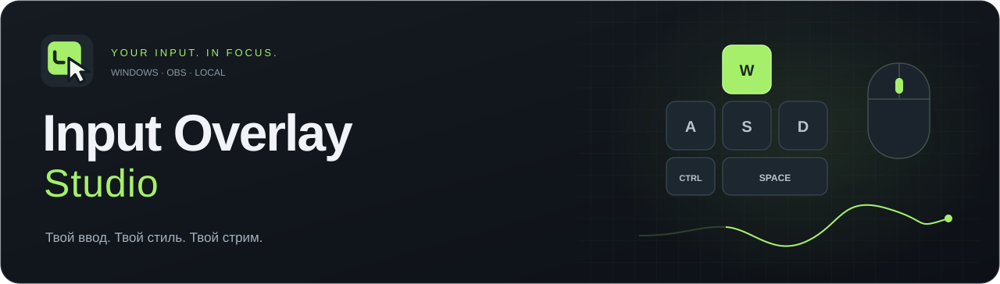
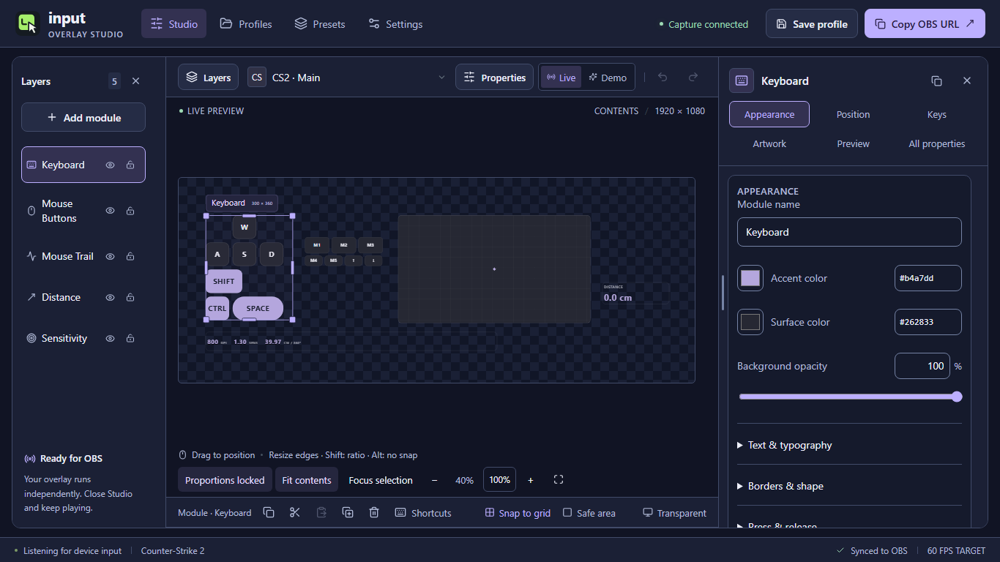
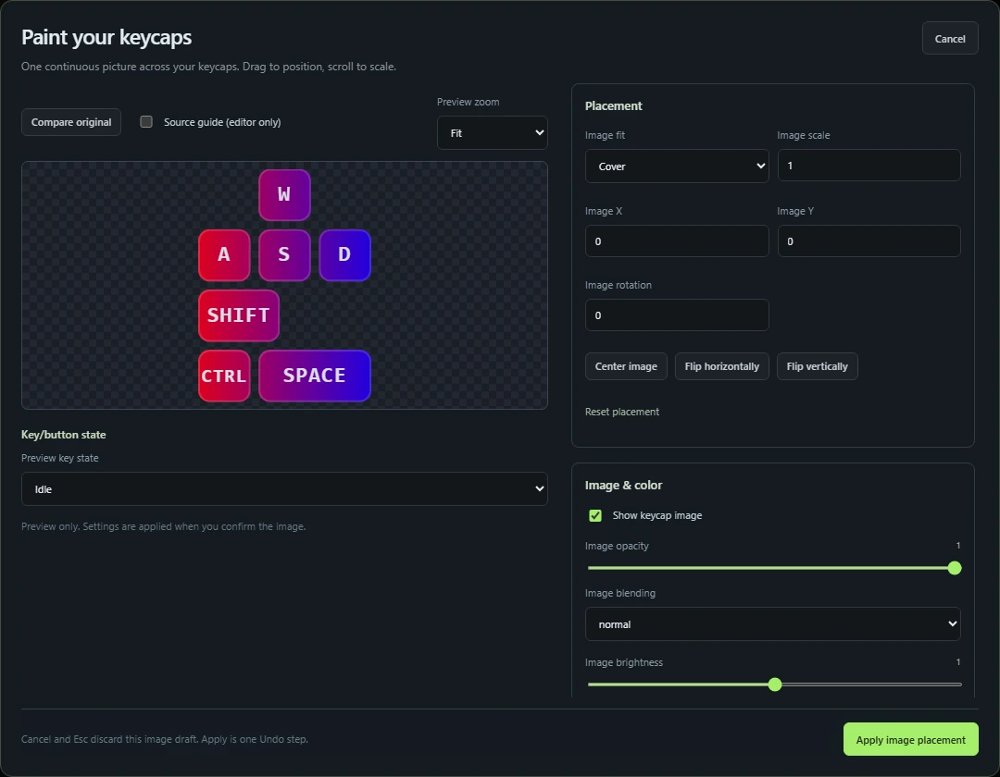

  

  <strong>Клавиатура, мышь и траектория движения — в твоём оформлении, прямо в OBS.</strong> 
  Визуальный редактор для Windows. Прозрачный оверлей. Работа локально.

  

  <a href="#в-игре">Посмотреть в деле</a> ·
  <a href="#быстрый-старт">Установка</a> ·
  <a href="docs/CUSTOMIZATION.md">Кастомизация</a> ·
  <a href="https://github.com/TheYamio/input-overlay-studio/releases/tag/v0.6.9">Что нового в v0.6.9</a>

## В игре

26 секунд реального геймплея: нажатия, кнопки мыши, след и пройденное расстояние.

https://github.com/user-attachments/assets/f6abb13c-c2d8-4a9d-b6cf-de1f52926017

## Собери свой оверлей

| Оформление | Ввод и движение |
| :--- | :--- |
| **Общий рисунок на кейкапах.** Одна полупрозрачная картинка через клавиши и кнопки мыши; промежутки остаются прозрачными. | **Клавиатура и мышь.** Одновременные нажатия, отдельные левые/правые модификаторы, M1–M5, колесо и аналоговая заливка. |
| **Точная настройка.** Положение, масштаб, поворот, отражение, смешивание и цветокоррекция картинки. Шрифты, рамки и эффекты нажатия. | **Mouse Trail.** Пять стилей следа, затухание, импульсы кликов, скорость и масштаб с учётом DPI. |
| **Своя раскладка.** Перетаскивание и размер каждой клавиши, назначение физическим нажатием, копирование стилей, Undo/Redo. | **Игровые профили.** DPI, sensitivity, cm/360 и дистанция. CS2, Valorant, Apex, Overwatch 2, KovaaK’s и ручные настройки. |

Семь переработанных заводских композиций, **Yamio preset**, собственные пресеты с описаниями и палитрами, JSON-экспорт со встроенными изображениями. Оформление синхронизируется с OBS; окно редактора можно закрыть, оставив захват в трее.

**В 0.6.9:** мастер первого запуска с выбором языка, понятные состояния подключения к OBS и более надёжное сохранение. Улучшены переводы и работа редактора с большими композициями; добавлена добровольная поддержка разработки. [Подробнее о релизе](docs/CHANGELOG.md).

Интерфейс «Полночь · ирис», высокая правая панель свойств, изменение размеров на холсте, импорт SVG-форм, настраиваемые горячие клавиши и независимые эффекты движения/подсветки с задержками. В Settings доступны 12 языков с отметкой **«Экспериментально»**. [Подробнее о языках](docs/LOCALIZATION.md).

<strong>Посмотреть редактор и настройку рисунка</strong>

### Всё на одном холсте

Перемещай модули, меняй размеры, настраивай слои и проверяй результат в Demo.

### Общий стиль для клавиш

Загрузи PNG, JPEG или WebP и настрой изображение в отдельном предпросмотре. Применение — один шаг Undo; отмена сохраняет прежний вид.

[Настройка оформления](docs/CUSTOMIZATION.md) · [Общий рисунок и визуальные возможности](docs/VISUAL_FEATURES.md)

## Быстрый старт

1. **[Скачай Windows x64 ZIP](https://github.com/TheYamio/input-overlay-studio/releases/download/v0.6.9/Input-Overlay-Studio-0.6.9-Windows-x64.zip)** и распакуй **весь архив**. Обе DLL должны оставаться рядом с `Input Overlay Studio.exe`.
2. **Запусти Studio.** Нужен установленный [Microsoft Edge WebView2 Runtime](https://developer.microsoft.com/microsoft-edge/webview2/#download-section).
3. **Настрой профиль и оформление.** Укажи DPI, игру и sensitivity; выбери тему и расположи модули.
4. **Нажми Copy OBS URL.** В OBS добавь **Browser Source / Источник браузера**, вставь ссылку и задай **1920 × 1080**.

Готово: фон оверлея прозрачен. Закрытие Studio оставляет приложение в трее; полный выход — **Exit** в меню трея. Demo служит для предпросмотра, а **Copy OBS URL** создаёт источник реального ввода.

[Подключение к OBS →](docs/OBS_SETUP.md)

## Полезное

| Задача | Инструкция |
| :--- | :--- |
| Настроить клавиши, стили и назначение кнопок | [Кастомизация](docs/CUSTOMIZATION.md) |
| Разобраться с сохранением и конфликтами | [Сохранение и синхронизация](docs/SAVING_AND_SYNC.md) |
| Собрать приложение или помочь проекту | [Разработка и сборка](docs/DEVELOPMENT.md) · [Сообщить об ошибке](https://github.com/TheYamio/input-overlay-studio/issues) |

<strong>Данные и приватность</strong>

Повседневная работа не требует интернета. Телеметрии, истории текстового ввода и внедрения DLL в игры нет. По умолчанию сервер доступен только локально: `127.0.0.1:4455` (WebSocket) и `127.0.0.1:4456` (HTTP).

Настройки и логи: `%LOCALAPPDATA%/InputOverlayStudio`. Существующий portable `config.json` рядом с exe сохраняет прежнее расположение данных. Для разработки можно задать `INPUT_OVERLAY_STUDIO_DATA_DIR`; `--tray` запускает захват без окна.

OBS-страница: `/studio/overlay.html`, web-редактор: `/studio/index.html`. Корень локального HTTP-сервера открывает Studio. Для LAN нужно явно изменить bind host и адреса источника. Ссылка OBS содержит токен доступа во фрагменте — не публикуй её. Экспортируемые профили токена не содержат. Текущий формат документа — v4; файлы v1–v3 больше не поддерживаются. Перед обновлением сохраните отдельную копию старых настроек.

---

**Открытый код · GPL-3.0.** Захват ввода развивается на основе [girlglock/input-overlay](https://github.com/girlglock/input-overlay). [Лицензия](LICENSE), сведения об исходных авторах и [лицензии зависимостей](THIRD_PARTY_NOTICES.md) сохранены. Исходники и скрипты сборки доступны вместе с релизами.
